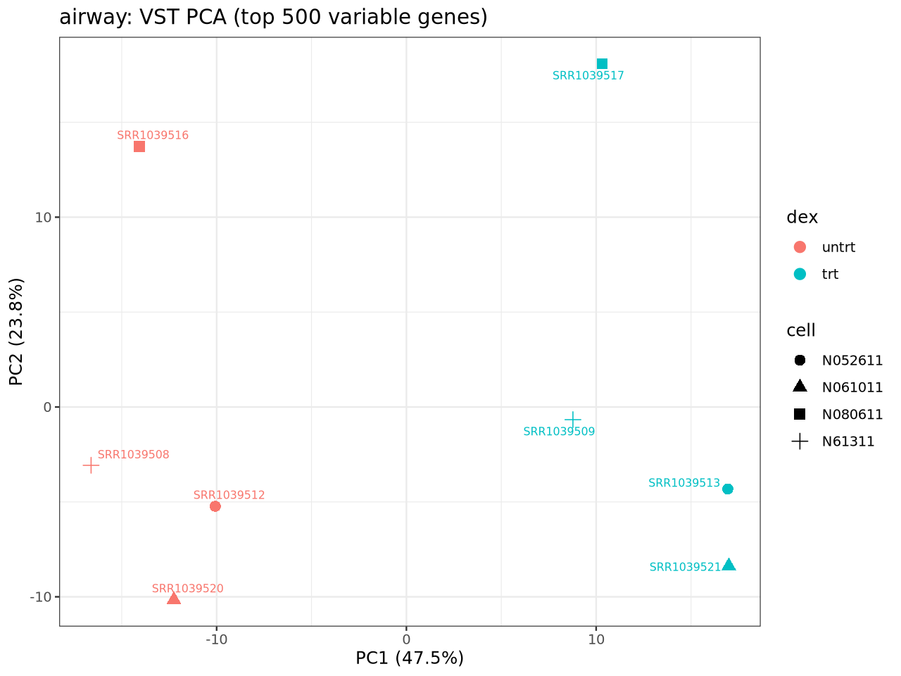
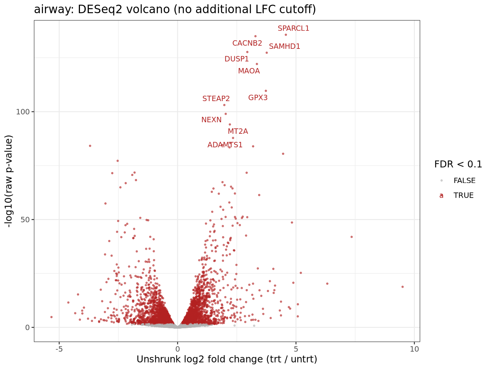
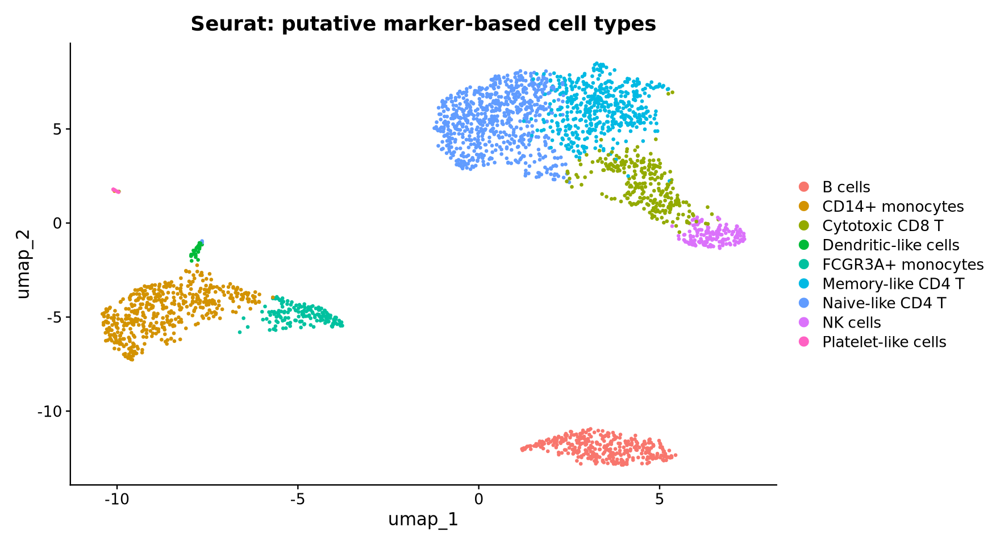
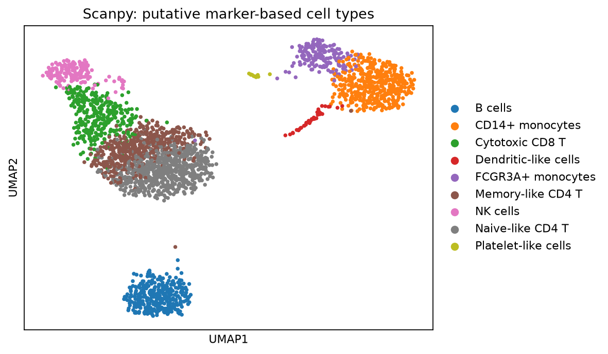

# RNA-seq 与 PBMC3k 实际复现项目

本项目已验证 airway **现成计数矩阵**的 DESeq2、edgeR、PyDESeq2，以及同一 PBMC3k 已过滤 UMI 数据的 Seurat、Scanpy 分析。学习文档是待核实的参考材料；验收数字读取实际产物，不为匹配参考数字调参。

nf-core/rnaseq 官方小型测试单独运行和验收，不能描述为 airway 原始 FASTQ 的完整复现。

## 项目结构

- [airway bulk 分析](projects/01-airway-bulk/README.md)：三个差异表达工具及比较。
- [PBMC3k 单细胞分析](projects/02-pbmc3k-single-cell/README.md)：Seurat、Scanpy 与补充诊断。
- [nf-core/rnaseq 官方测试](projects/03-nfcore-rnaseq-test/README.md)：固定版本的独立小型流程测试。

各目录包含各自的脚本、工作流、环境记录、方法文档及本地结果。原项目的独有历史资料保存在 `shared/history/`，迁移映射见 `manifests/consolidation.json`。历史报告保留了运行时的旧路径；跨主机复现尚未验证。

## 复现矩阵分析

当前 Linux 环境使用用户目录 Miniforge，系统 R/Python 未被覆盖。各子项目的 `environment/` 提供 Linux explicit 环境锁；同名已有环境先核查兼容性。新机器上的环境重建尚未实测，不应覆盖系统环境。

进入对应子项目根目录，按其 README 恢复或验证隔离环境，然后使用新输出目录运行：

```bash
cd projects/01-airway-bulk
conda run --no-capture-output -n biolearn-workflow snakemake --cores 4 --resources mem_mb=14000 --config output_root=results/my-new-run
```

PBMC3k 使用同样的 Snakemake 命令，但须先进入 `projects/02-pbmc3k-single-cell`，按[子项目说明](projects/02-pbmc3k-single-cell/README.md)准备输入及独立的诊断 venv。若 conda 不在 PATH，可在命令末尾添加 `--config conda=/实际路径/bin/conda`。

两个工作流分别跟踪相应产物；PBMC 主结果变化会触发下游 doublet、参考映射和图诊断。运行使用独立 attempt，验收成功后发布；缺图时可能重跑对应路线的完整分析。主分析随机种子为 42、线程为 2；方法与参数见 [bulk 方法](projects/01-airway-bulk/docs/bulk-methods.md)及 [PBMC3k 方法](projects/02-pbmc3k-single-cell/docs/pbmc3k-methods.md)。

## 实际结果对照

以下数字来自 2026-10-10 的本机干净验收产物；拆分后的本机运行亦记录了相同关键结果。输入、参数、环境与历史验证范围见本地保留的[干净目录验收报告](shared/history/2026-10-10/archive-inventory/original/results/reproduction/acceptance-20261010T234118Z/acceptance-report.md)；该历史文件不纳入 Git，报告中的旧路径是当时的路径。

| 分析       | 实际输入/过滤                    | 实际结果          |
| -------- | -------------------------- | ------------- |
| DESeq2   | 63,677 基因、8 样本；预过滤 16,596  | FDR<0.1：4,916 |
| edgeR    | 同一输入；filterByExpr 16,860   | FDR<0.1：6,550 |
| PyDESeq2 | 同一输入；预过滤 16,596            | FDR<0.1：4,685 |
| Seurat   | 2,700 → 2,638 细胞，13,714 基因 | 9 簇、2,000 HVG |
| Scanpy   | 同一输入；同样保留 2,638 细胞         | 9 簇、1,838 HVG |

三种 bulk 方法共同显著基因 4,611；DESeq2/PyDESeq2 显著集合 Jaccard 为 0.935685。单细胞按条形码共有 2,638 个细胞，两侧独有均为 0；ARI=0.627931、NMI=0.754505。簇数不是验收目标，注释也不是独立生物学真值。

2026-10-10 干净目录验收包括 217 个声明产物回读、独立检查 158/158、补充诊断 18/18 与 4 个图变体；缺图重建及最终 dry-run 也有历史证据。2026-10-30 拆分后的矩阵运行分别通过 bulk 39/39、PBMC3k 83/83；更名后的完整科学流程未重新运行。

## 结果图预览

以下图片直接复制自本项目干净验收运行的实际产物，供文档展示；各子项目本地结果目录保留源文件。

| airway：样本 PCA               | airway：DESeq2 火山图                   |
| --------------------------- | ----------------------------------- |
|  |  |

| PBMC3k：Seurat         | PBMC3k：Scanpy         |
| --------------------- | --------------------- |
|  |  |

PBMC3k 标签为基于 marker 的推定注释，不是独立实验真值；两条路线使用不同的降维、邻居图和聚类实现，UMAP 几何形状不能直接逐点比较。

## nf-core/rnaseq 独立测试

固定版本 rnaseq 3.27.0，提交 `a1fcdddd3b826fe46eb46f0479f2ff8a7815af05`，Nextflow 25.10.4，Java 21。[子项目 README](projects/03-nfcore-rnaseq-test/README.md)提供固定版本获取、容器预检和新 attempt 的运行命令。

历史 attempt-1 因 Docker 缺失退出 1；attempt-2 退出 0，234/234 任务成功、267/267 独立核验通过；8 个序列化文件、5 个 BAM、128 个 PDF/132 页和 MultiQC 曾实际回读。RGB 展示兼容修复单独保存在 `presentation-corrected-4/`，未改变官方科学数据。2026-10-30 拆分后官方小型测试再次退出 0，234/234 任务完成、267/267 独立核验通过；记录在 `projects/03-nfcore-rnaseq-test/results/nfcore/new-attempt/`。

运行需要 Docker、对应隔离环境和网络。实际完成状态应读取运行的 `completion-status.json`，不能根据脚本存在或参考文档勾选判定成功。资源与阻塞记录见 [官方测试说明](projects/03-nfcore-rnaseq-test/docs/nfcore-test.md)。

## 局限与进度

- bulk 输入已是计数矩阵，未验证原始 reads 的质控、比对和计数。
- PBMC 输入已过滤，不含空液滴。Scrublet 历史诊断 36/2700 疑似 doublet（主 QC 内 34），未据此删除细胞。独立缩减参考映射约 80%–81% 一致，缺少部分关键 marker 和 platelet 参考类；注释仍为推定，实验真值未取得。
- 两条单细胞路线的 HVG、回归、PCA、邻居图和聚类实现不同；控制实验只能解释部分参数敏感性。
- 跨平台、软件版本或线程库变化不能承诺图像字节及数值完全相同；固定簇注释计划需要重新核对数据、簇标签和 marker。
- 完整人类参考基因组不在范围内；数据、完整结果、历史证据及隔离环境不一定被 Git 跟踪。同盘历史资料不等于异地备份。

持续记录见 [docs/progress.md](docs/progress.md)。
