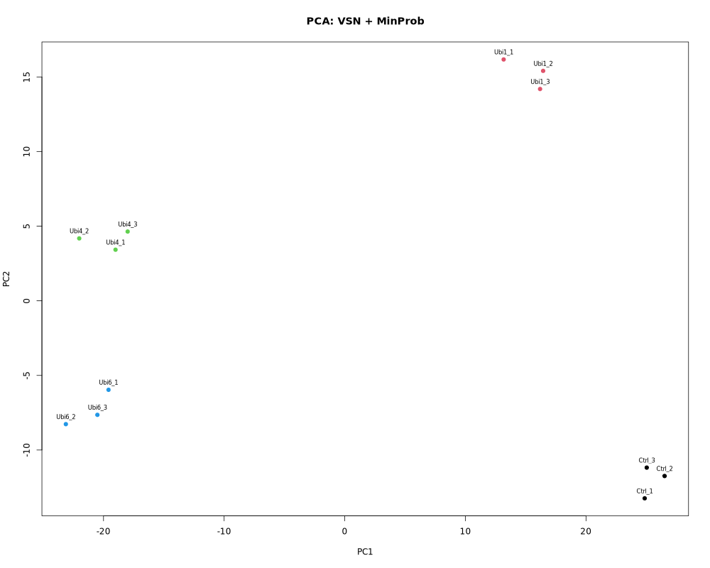
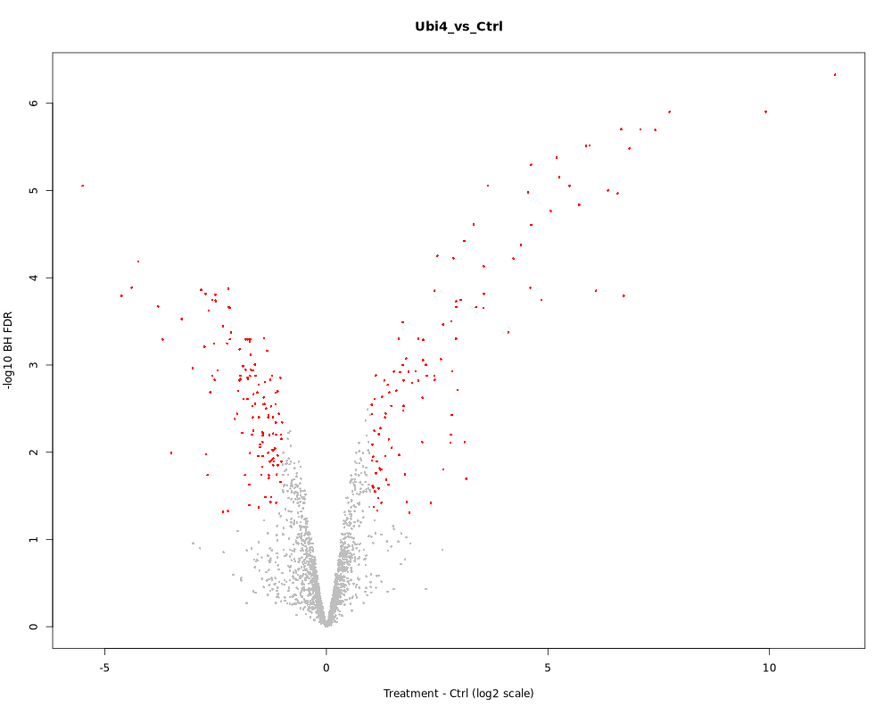

# RNA-seq、单细胞与蛋白组可复现分析

本仓库包含四个独立子项目：airway 现成计数矩阵差异表达、PBMC3k 已过滤 UMI 矩阵分析、nf-core/rnaseq 官方小型测试，以及 UbiLength 蛋白组矩阵差异富集。结果数字来自实际产物；学习参考文档中的代码、勾选和数字不作为本机验收证据。

## 项目导航

| 子项目 | 输入与目标 | 运行及方法 |
| --- | --- | --- |
| airway bulk | 现成计数矩阵；DESeq2、edgeR、PyDESeq2 | [README](projects/01-airway-bulk/README.md) · [方法](projects/01-airway-bulk/docs/bulk-methods.md) |
| PBMC3k | 已过滤 UMI；Seurat、Scanpy 与补充诊断 | [README](projects/02-pbmc3k-single-cell/README.md) · [方法](projects/02-pbmc3k-single-cell/docs/pbmc3k-methods.md) |
| nf-core/rnaseq | 固定版本的官方小型流程测试 | [README](projects/03-nfcore-rnaseq-test/README.md) · [测试说明](projects/03-nfcore-rnaseq-test/docs/nfcore-test.md) |
| UbiLength 蛋白组 | LFQ 矩阵；差异富集与缺失值敏感性分析 | [README](projects/04-proteomics-matrix/README.md) · [方法](projects/04-proteomics-matrix/docs/methods.md) · [验收](projects/04-proteomics-matrix/docs/validation.md) |

## 运行与环境

先进入对应子项目，按其 README 准备输入并恢复或验证隔离环境。各子项目的 `environment/` 提供 Linux explicit 锁文件；系统 R/Python 未被覆盖。同名环境先检查兼容性，跨主机重建尚未实测。

三个矩阵项目使用 Snakemake，每次科学运行指定新的 `output_root`；nf-core 使用独立的 Nextflow 入口。子项目配置、资源要求和输入准备不同，请使用各自运行命令。

## 实际结果与展示

以下区块与子项目 README 由同一份[实测结果摘要](docs/results-summary.json)生成，图像来自所列本机运行产物。2026-10-31 仅同步文档与图片，没有重新执行科学分析。

<!-- BEGIN VERIFIED RESULTS -->

### [airway bulk 差异表达](projects/01-airway-bulk/README.md)

本机验证日期：2026-10-30。结构与运行验收 39/39 PASS。

| 方法 | 输入基因 | 预过滤基因 | FDR < 0.1 显著基因 |
| --- | --- | --- | --- |
| deseq2 | 63677 | 16596 | 4916 |
| edger | 63677 | 16860 | 6550 |
| pydeseq2 | 63677 | 16596 | 4685 |

8 个样本；设计 ~ cell + dex，trt 对 untrt。显著性不叠加效应阈值；不同方法的过滤和统计模型不同。仅分析现成计数矩阵。

结果来源（本地运行产物，未随 Git 发布）：

- `projects/01-airway-bulk/results/new-run/bulk/analysis_summary.csv`
- `projects/01-airway-bulk/results/new-run/bulk/acceptance_checks.csv`

图表与来源校验值保存在受版本控制的结果摘要中。

airway：VST PCA

airway：DESeq2 火山图，颜色依据 FDR < 0.1

### [PBMC3k 单细胞分析](projects/02-pbmc3k-single-cell/README.md)

本机验证日期：2026-10-30。结构与运行验收 83/83 PASS。

| 路线 | 原始细胞 | QC 保留细胞 | 簇数 |
| --- | --- | --- | --- |
| seurat | 2700 | 2638 | 9 |
| scanpy | 2700 | 2638 | 9 |

已过滤 UMI 矩阵；共有细胞 2638，ARI=0.627931，NMI=0.754505。细胞类型为 marker 支持的推定注释；簇数不是验收目标，两侧 UMAP 坐标不能逐点比较。

结果来源（本地运行产物，未随 Git 发布）：

- `projects/02-pbmc3k-single-cell/results/new-run/pbmc3k/analysis_summary.csv`
- `projects/02-pbmc3k-single-cell/results/new-run/pbmc3k/comparison_metrics.json`
- `projects/02-pbmc3k-single-cell/results/new-run/pbmc3k/acceptance_checks.csv`

图表与来源校验值保存在受版本控制的结果摘要中。

PBMC3k：seurat 推定细胞类型 UMAP

PBMC3k：scanpy 推定细胞类型 UMAP

### [nf-core/rnaseq 官方小型测试](projects/03-nfcore-rnaseq-test/README.md)

本机验证日期：2026-10-30。运行及独立验收 PASS；版本提交 a1fcdddd3b826fe46eb46f0479f2ff8a7815af05。

| 版本 | 退出码 | 完成任务 / 总任务 | 独立验收通过 / 总项 |
| --- | --- | --- | --- |
| 3.27.0 | 0 | 234/234 | 267/267 |

test,docker 官方小型测试；不是 airway 原始 FASTQ 的完整复现。任务与验收统计用于展示流程结果。

结果来源（本地运行产物，未随 Git 发布）：

- `projects/03-nfcore-rnaseq-test/results/nfcore/new-attempt/verification/summary.json`
- `projects/03-nfcore-rnaseq-test/results/nfcore/new-attempt/completion-status.json`

图表与来源校验值保存在受版本控制的结果摘要中。

### [UbiLength 蛋白组差异富集](projects/04-proteomics-matrix/README.md)

本机验证日期：2026-10-30。实际产物验收 PASS；固定种子复跑及缺图恢复已验证。

| 比较 | 检验蛋白组 | BH FDR < 0.05 | 同时绝对 log2FC ≥ 1 | 不插补可检验 |
| --- | --- | --- | --- | --- |
| Ubi1_vs_Ctrl | 1898 | 128 | 104 | 1486 |
| Ubi4_vs_Ctrl | 1898 | 395 | 242 | 1348 |
| Ubi6_vs_Ctrl | 1898 | 393 | 261 | 1352 |

12 个样本；DEP 1.28.0，VSN、MinProb q=0.01、seed=42、limma，逐比较 BH 校正。正效应表示处理组相对 Ctrl 富集。共同可检验集合的主路线/不插补显著集合 Jaccard 依次为 0.100、0.917、0.769；Ubi1 对缺失值处理尤其敏感。属于蛋白互作富集，不代表全细胞蛋白表达变化。

结果来源（本地运行产物，未随 Git 发布）：

- `projects/04-proteomics-matrix/results/final/summary.csv`
- `projects/04-proteomics-matrix/results/final/filter_counts.csv`
- `projects/04-proteomics-matrix/results/final/sensitivity_summary.csv`
- `projects/04-proteomics-matrix/results/final/acceptance.json`

图表与来源校验值保存在受版本控制的结果摘要中。

UbiLength：VSN + MinProb 后 PCA

Ubi4 vs Ctrl：差异富集火山图

<!-- END VERIFIED RESULTS -->

## 验收与局限

- airway 从现成矩阵开始，未验证该实验原始 reads 的质控、比对和计数；独立 nf-core 官方测试不能替代这部分复现。
- PBMC3k 输入已过滤，不含空液滴。细胞类型为推定注释，UMAP 不能逐点对齐。诊断中的疑似 doublet 未据此删除，参考映射也不是实验真值；细节见子项目方法文档。
- UbiLength 是蛋白互作富集实验；插补依赖缺失机制假设，敏感性分析不能视为独立生物学验证。
- 软件、平台或线程库变化不能保证图像字节和数值完全相同。原始数据、完整报告、日志、环境和历史证据通常不纳入 Git；本地路径在 GitHub 上不可直接访问。

## 文档维护与历史

修改结果展示时，先确认实际验收产物，再运行 `python3 scripts/sync_readmes.py --refresh` 更新摘要、展示图及两级 README。普通 `python3 scripts/sync_readmes.py` 从已提交摘要重新生成；`--check` 只读检查生成区块、图片 SHA-256 和链接，不依赖本地完整运行结果。详见[同步说明](docs/readme-sync.md)。

[进度记录](docs/progress.md)记录完成项、失败修复和下一步；[工作约定](AGENTS.md)规定范围与证据要求。子项目 README 是维护入口，根 `docs/` 中原有方法文档和学习材料保留作历史参考。独有历史资料位于本地 `shared/history/`，归并说明见 [manifests](manifests/README.md)；历史报告中的旧路径不保证可执行。
