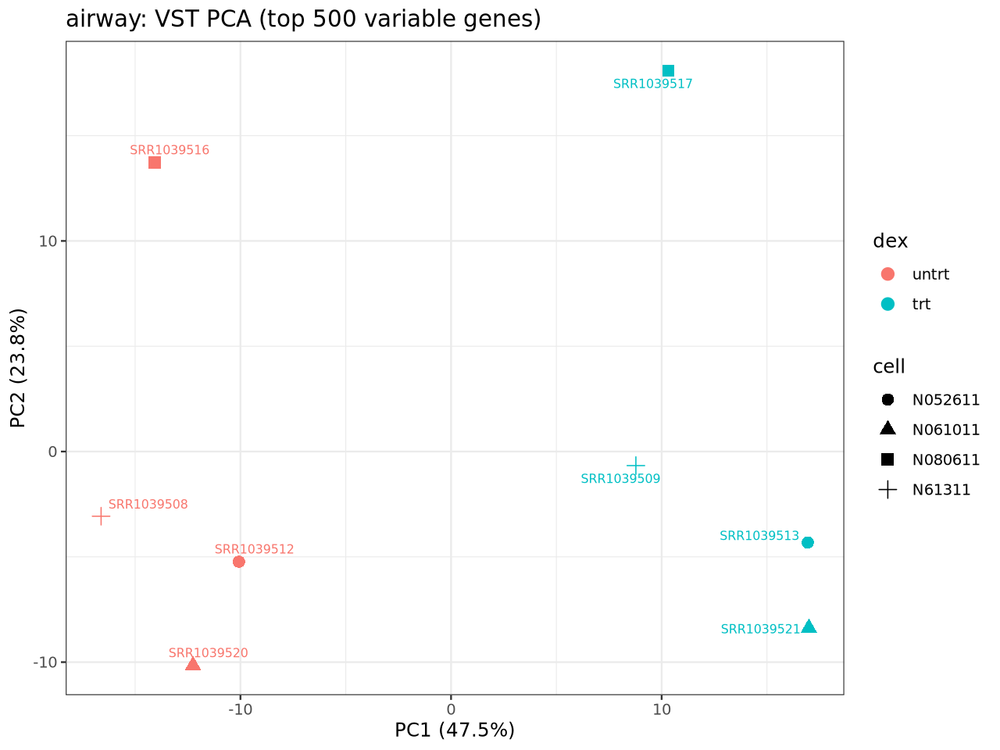
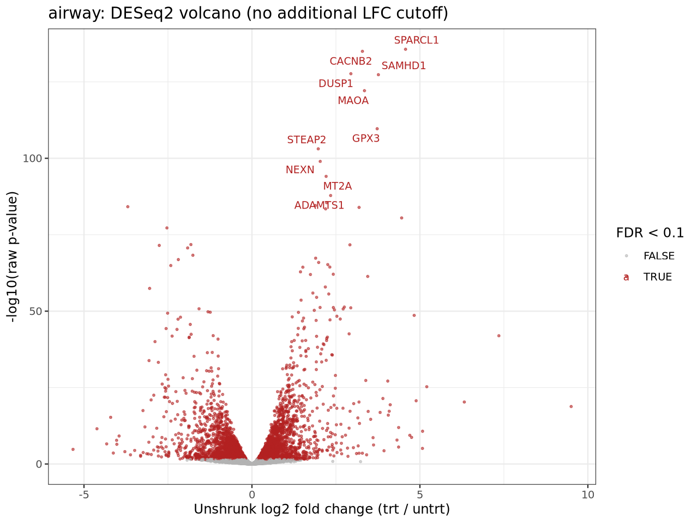

# airway bulk 差异表达

[返回项目总览](../../README.md)

## 分析目标

airway 现成计数矩阵的三种差异表达方法比较。

## 输入

8 个样本；设计 `~ cell + dex`，trt 对 untrt，FDR < 0.1。此项目不从原始 FASTQ 开始。

## 环境与执行

在子项目根目录执行。先将 Miniforge 的 `bin` 加入 PATH，或在 Snakemake 命令中使用 `--config conda=/实际路径/bin/conda`。根据 `environment/` 中的 explicit 锁文件恢复或验证 `biolearn-r`、`biolearn-py`、`biolearn-workflow` 三个隔离环境，Linux 平台依赖与构建版本应与锁文件一致。

```bash
conda create -n biolearn-r --file environment/biolearn-r.linux-64.explicit.txt
conda create -n biolearn-py --file environment/biolearn-py.linux-64.explicit.txt
conda create -n biolearn-workflow --file environment/biolearn-workflow.linux-64.explicit.txt
```

新运行使用新的输出目录，避免重写历史结果：

```bash
conda run --no-capture-output -n biolearn-workflow snakemake --cores 4 --resources mem_mb=14000 --config output_root=results/my-new-run
```

结果中的历史路径来自之前的运行记录；跨主机环境重建尚未验证。

## 实际结果

<!-- BEGIN VERIFIED RESULTS -->

本机验证日期：2026-10-30。结构与运行验收 39/39 PASS。

| 方法 | 输入基因 | 预过滤基因 | FDR < 0.1 显著基因 |
| --- | --- | --- | --- |
| deseq2 | 63677 | 16596 | 4916 |
| edger | 63677 | 16860 | 6550 |
| pydeseq2 | 63677 | 16596 | 4685 |

8 个样本；设计 ~ cell + dex，trt 对 untrt。显著性不叠加效应阈值；不同方法的过滤和统计模型不同。仅分析现成计数矩阵。

结果来源（本地运行产物，未随 Git 发布）：

- `results/new-run/bulk/analysis_summary.csv`
- `results/new-run/bulk/acceptance_checks.csv`

图表与来源校验值保存在受版本控制的结果摘要中。

## 结果展示



airway：VST PCA



airway：DESeq2 火山图，颜色依据 FDR < 0.1

<!-- END VERIFIED RESULTS -->

## 验收与局限

2026-10-30 拆分后的本机重跑已完成；运行及最终依赖检查保存在本地 `run.log`、`final-dry-run.log`。2026-10-31 仅同步文档。未进行跨主机环境重建；方法之间的过滤和统计差异不能仅凭显著数量评价优劣。

## 相关文档

[方法说明](docs/bulk-methods.md) · [全项目进度](../../docs/progress.md)
