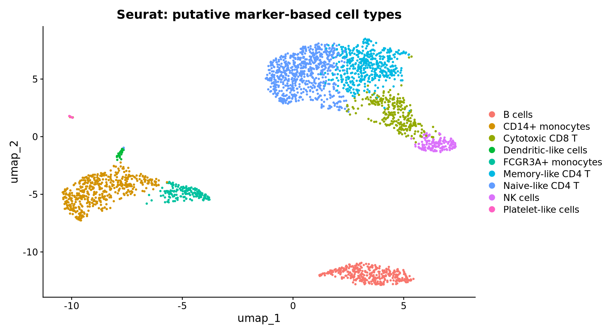
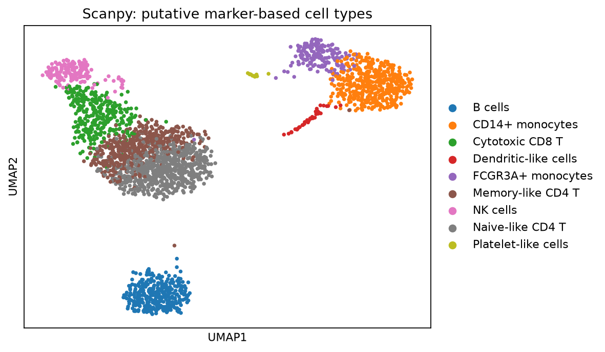

# PBMC3k 单细胞分析

[返回项目总览](../../README.md)

## 分析目标

使用 Seurat 与 Scanpy 分析同一 PBMC3k 数据，比较细胞保留、聚类及推定注释。

## 输入

如数据尚未保存到本地，从 10x 获取并校验后解压：

```bash
mkdir -p data/pbmc3k
curl -fL https://cf.10xgenomics.com/samples/cell/pbmc3k/pbmc3k_filtered_gene_bc_matrices.tar.gz -o data/pbmc3k/pbmc3k_filtered_gene_bc_matrices.tar.gz
echo '847d6ebd9a1ec9a768f2be7e40ca42cbfe75ebeb6d76a4c24167041699dc28b5  data/pbmc3k/pbmc3k_filtered_gene_bc_matrices.tar.gz' | sha256sum -c -
tar -xzf data/pbmc3k/pbmc3k_filtered_gene_bc_matrices.tar.gz -C data/pbmc3k
```

## 环境与执行

在子项目根目录执行。先将 Miniforge 的 `bin` 加入 PATH，或在 Snakemake 命令中使用 `--config conda=/实际路径/bin/conda`。根据 `environment/` 中的 explicit 锁文件恢复或验证 `biolearn-r`、`biolearn-py`、`biolearn-workflow` 三个隔离环境，Linux 平台依赖与构建版本应与锁文件一致。

```bash
conda create -n biolearn-r --file environment/biolearn-r.linux-64.explicit.txt
conda create -n biolearn-py --file environment/biolearn-py.linux-64.explicit.txt
conda create -n biolearn-workflow --file environment/biolearn-workflow.linux-64.explicit.txt
```

PBMC 诊断使用本子项目独立 venv：

```bash
conda run -n biolearn-py python -m venv --system-site-packages environment/validation-venv
environment/validation-venv/bin/python -m pip install -r environment/validation-extra-requirements.txt
```

新运行使用新的输出目录，避免重写历史结果：

```bash
conda run --no-capture-output -n biolearn-workflow snakemake --cores 4 --resources mem_mb=14000 --config output_root=results/my-new-run
```

结果中的历史路径来自之前的运行记录；跨主机环境重建尚未验证。

## 实际结果

<!-- BEGIN VERIFIED RESULTS -->

本机验证日期：2026-10-30。结构与运行验收 83/83 PASS。

| 路线 | 原始细胞 | QC 保留细胞 | 簇数 |
| --- | --- | --- | --- |
| seurat | 2700 | 2638 | 9 |
| scanpy | 2700 | 2638 | 9 |

已过滤 UMI 矩阵；共有细胞 2638，ARI=0.627931，NMI=0.754505。细胞类型为 marker 支持的推定注释；簇数不是验收目标，两侧 UMAP 坐标不能逐点比较。

结果来源（本地运行产物，未随 Git 发布）：

- `results/new-run/pbmc3k/analysis_summary.csv`
- `results/new-run/pbmc3k/comparison_metrics.json`
- `results/new-run/pbmc3k/acceptance_checks.csv`

图表与来源校验值保存在受版本控制的结果摘要中。

## 结果展示



PBMC3k：seurat 推定细胞类型 UMAP



PBMC3k：scanpy 推定细胞类型 UMAP

<!-- END VERIFIED RESULTS -->

## 验收与局限

2026-10-30 拆分后的本机重跑已完成，补充诊断 18/18、图变体 4/4 通过；回读记录见本地 `rds-readback.log` 和 `object-readback.log`。2026-10-31 仅同步文档。较早的迁移诊断记录保留在本地 `results/migration-check/pbmc_validation/`。

已过滤矩阵不包含空液滴；细胞类型是推定注释。历史诊断疑似 doublet 未据此删除，缩减参考映射不构成独立真值。跨主机环境重建尚未验证。

## 相关文档

[方法说明](docs/pbmc3k-methods.md) · [全项目进度](../../docs/progress.md)
