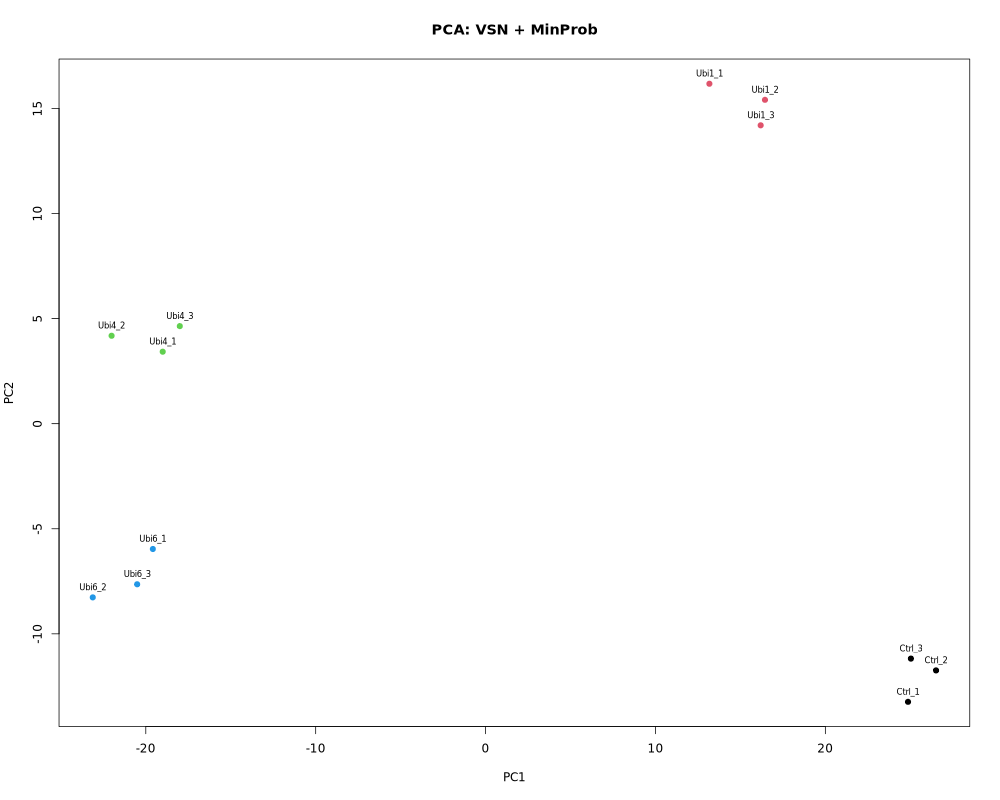
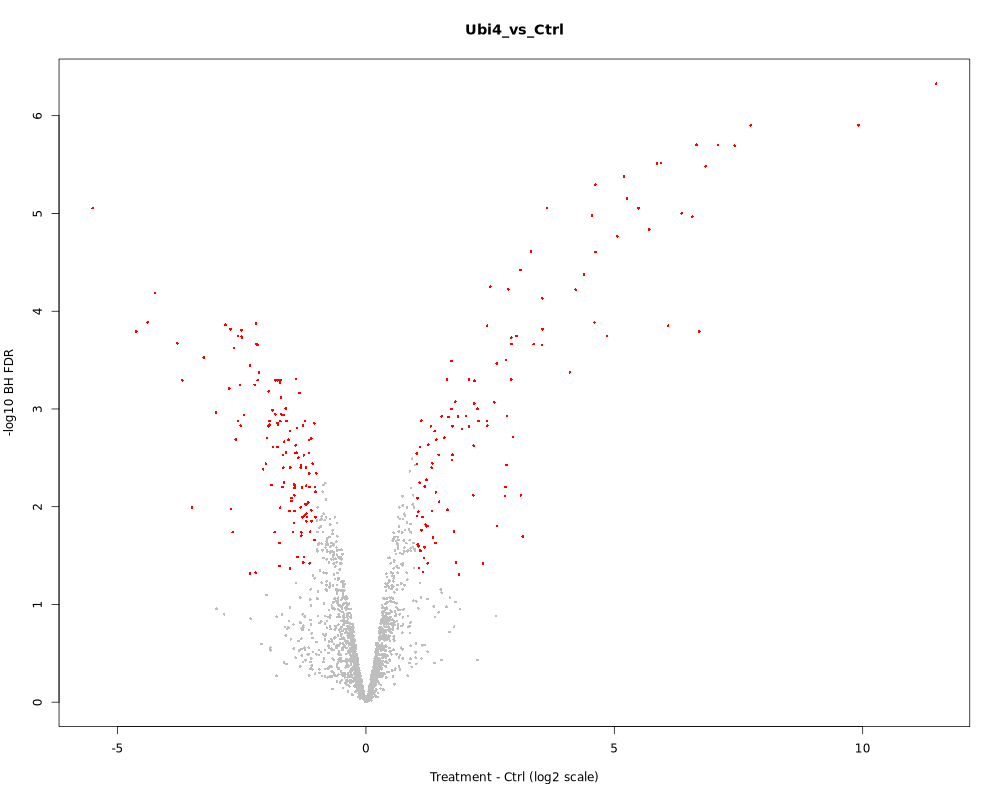
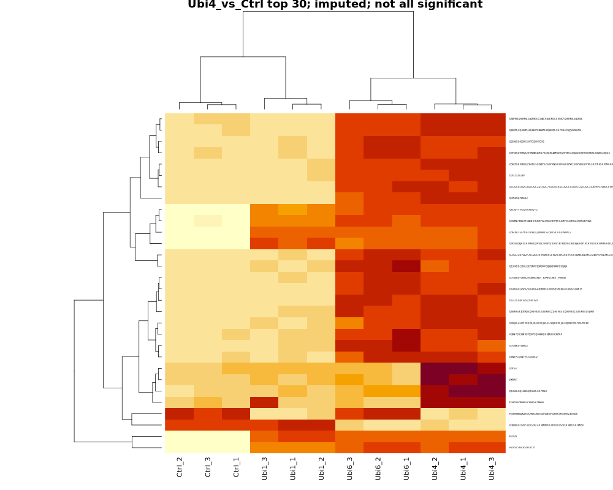

# UbiLength 蛋白组定量矩阵分析

[返回项目总览](../../README.md)

## 分析目标

蛋白互作富集实验的 LFQ 示例：DEP 预处理、limma 差异富集与不插补敏感性分析，不代表全细胞蛋白表达变化。

## 输入

`data/matrix.csv`：`protein_id`（唯一蛋白组 ID）、`gene`（可重复）、三个 MaxQuant 标记列 `Reverse`、`Potential.contaminant`、`Only.identified.by.site`，及与样本 label 严格匹配的数值列。`data/samples.csv`：`label,condition,replicate`。强度必须为非负线性 LFQ，零代表缺失。当前工作流自动从固定 DEP 示例导出这两个文件；接入其他数据时须停用 export 规则，先核实定量尺度和实验设计。

## 环境与执行

在本目录执行。Linux 环境锁在 `environment/`；现有环境应先验证，缺失时按锁创建独立环境：

```bash
/home/a/miniforge3/bin/conda create -n proteomics-analysis --file environment/proteomics-analysis.linux-64.explicit.txt
# 工作流环境缺失时，同样使用 biolearn-workflow.linux-64.explicit.txt 创建
python3 scripts/download.py
/home/a/miniforge3/envs/proteomics-analysis/bin/Rscript scripts/test.R
/home/a/miniforge3/bin/conda run --no-capture-output -n biolearn-workflow snakemake --cores 2 --config output_root=results/my-new-run
/home/a/miniforge3/envs/proteomics-analysis/bin/Rscript scripts/validate.R results/my-new-run
```

也可运行 `bash scripts/run.sh` 自动创建唯一输出目录并保存下载和工作流日志。

新机器需修改 `workflow/config.yaml` 中 Rscript 路径；跨主机环境重建未验证。每次科学运行指定新的输出目录；已有目录仅用于恢复缺失产物。配置参数通过编辑 YAML 设置，命令行仅覆盖 `output_root` 和 `rscript`。输出目录的 config.yaml 记录实际使用的分析参数。

打开 `results/my-new-run/report.html` 查看报告；表格、图片、绘图源数据、中间 RDS、环境版本、日志和 SHA-256 清单都保留在同一目录。无显著结果时显著表保留表头。参考数字不作为验收目标。

## 实际结果

<!-- BEGIN VERIFIED RESULTS -->

本机验证日期：2026-10-30。实际产物验收 PASS；固定种子复跑及缺图恢复已验证。

| 比较 | 检验蛋白组 | BH FDR < 0.05 | 同时绝对 log2FC ≥ 1 | 不插补可检验 |
| --- | --- | --- | --- | --- |
| Ubi1_vs_Ctrl | 1898 | 128 | 104 | 1486 |
| Ubi4_vs_Ctrl | 1898 | 395 | 242 | 1348 |
| Ubi6_vs_Ctrl | 1898 | 393 | 261 | 1352 |

12 个样本；DEP 1.28.0，VSN、MinProb q=0.01、seed=42、limma，逐比较 BH 校正。正效应表示处理组相对 Ctrl 富集。共同可检验集合的主路线/不插补显著集合 Jaccard 依次为 0.100、0.917、0.769；Ubi1 对缺失值处理尤其敏感。属于蛋白互作富集，不代表全细胞蛋白表达变化。

结果来源（本地运行产物，未随 Git 发布）：

- `results/final/summary.csv`
- `results/final/filter_counts.csv`
- `results/final/sensitivity_summary.csv`
- `results/final/acceptance.json`

图表与来源校验值保存在受版本控制的结果摘要中。

## 结果展示



UbiLength：VSN + MinProb 后 PCA



Ubi4 vs Ctrl：差异富集火山图



Ubi4 vs Ctrl：插补后排名前 30 蛋白热图，不代表全部显著

<!-- END VERIFIED RESULTS -->

## 验收与局限

完整图表报告位于本地 `results/final/report.html`，未随 Git 发布。2026-10-30 已完成运行、产物回读、固定种子复跑和缺图恢复；2026-10-31 仅同步文档。单侧全缺失蛋白的结果依赖插补；新机器安装、其他输入以及无显著结果的完整端到端场景未验证。

## 相关文档

[方法说明](docs/methods.md) · [本机验收](docs/validation.md) · [全项目进度](../../docs/progress.md)
